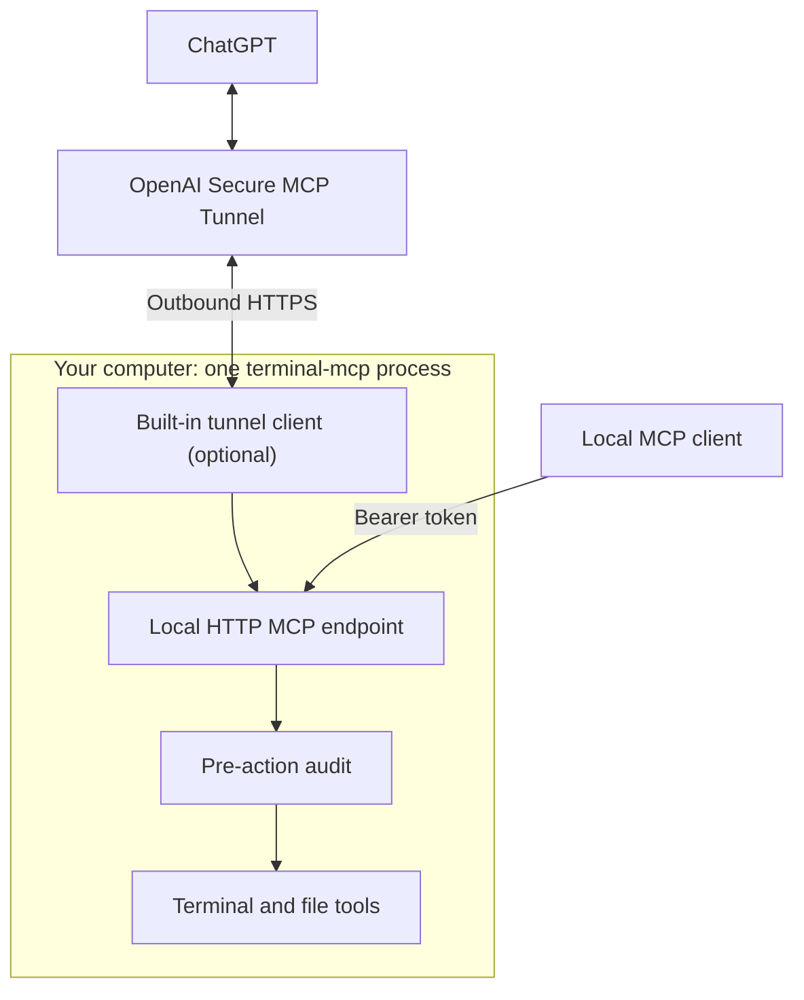

# Local Terminal MCP

Local Terminal MCP lets an AI client work with processes and files on your computer. It uses the [Model Context Protocol (MCP)](https://modelcontextprotocol.io/).

You can use it as a **local MCP server** or connect it to **ChatGPT** through a built-in [OpenAI Secure MCP Tunnel](https://developers.openai.com/api/docs/guides/secure-mcp-tunnels). The same server provides the same 14 tools in both modes.

**Security:** The server runs commands with your operating-system account permissions. It is **not a sandbox**. Connect only clients you trust.

## Choose a connection

| Mode | Use it when | What runs |
| --- | --- | --- |
| Local server (default) | Your MCP client runs on the same computer. | One `terminal-mcp` process. |
| Local server + ChatGPT tunnel | You want ChatGPT to use your local tools. | The same process, with the official OpenAI Tunnel SDK inside it. |



The HTTP endpoint listens on `127.0.0.1:8090/mcp` by default. It does not accept public network connections. When you enable the tunnel, the built-in client asks OpenAI for requests over **outbound HTTPS**. You do not need a public IP address or an open inbound port.

## Build and start

The project supports macOS, Linux, and Windows. To build it, you need **Go 1.27.3 or later**.

On macOS or Linux, run these commands from the repository directory:

```sh
make build
./bin/terminal-mcp start
./bin/terminal-mcp status
```

The first `start` installs a private copy of the executable and runs it in the background. Later starts use that installed copy. The server does not start automatically when you log in or restart your computer.

The `file_*` tools use absolute paths inside the configured `file_root`. On a new macOS/Linux installation, the default is the directory where you first run `start`. On Windows, the default is your home directory. Existing saved standalone settings keep their root. Use `status` to see the active root. To change it, stop the server and run `start --file-root=/absolute/path`. This limit does **not** apply to terminal commands.

You can also run it in the foreground:

```sh
./bin/terminal-mcp serve
```

Press `Ctrl+C` to stop a foreground server. Do not start a second server on the same port.

**Local MCP client settings:**

- **Server URL:** `http://127.0.0.1:8090/mcp`
- **Authentication:** Bearer token from `~/.config/terminal-mcp/token` (created on the first default HTTP start).

Configure the token in your local MCP client. Do not paste the token into a prompt or a public configuration file.

If `start` fails, read the error in your terminal. For a running background server, use `status` and check `~/.config/terminal-mcp/logs/server.stderr.log` for diagnostics. Windows uses [different log paths](docs/WINDOWS.md#logs).

For Windows installation, native ConPTY support, and Windows paths, use the [Windows guide](docs/WINDOWS.md). If your MCP host starts its own server process, you can instead use `./bin/terminal-mcp --transport=stdio`. This mode does not use the HTTP token or the built-in tunnel; audit is off by default in stdio mode.

## Connect ChatGPT with the built-in tunnel

This is **optional**. You do not need a separate `tunnel-client` program.

1. Open [OpenAI Platform Tunnels](https://platform.openai.com/settings/organization/tunnels). Create a tunnel or select an existing one.
   For a new tunnel, set **Name** to `Local Terminal MCP` and **Description** to `Run terminal commands, manage processes, and work with files on my computer.`
   Select your Platform organization and, if listed, the ChatGPT workspace that will use the tunnel.
   Leave **Restrict client network access** off unless your organization requires it. Save the tunnel and copy the tunnel ID.
2. Open [OpenAI API keys](https://platform.openai.com/settings/organization/api-keys) and create a secret key (the runtime key).
   Set **Name** to `Tunnel Client API Key` and **Permissions** to **Restricted**.
   Under **Tunnels**, select **Read** and **Use** only. Leave all other API permissions at **None**.
   Set an expiration date. Before it expires, create a replacement key, update the private key file, and restart `terminal-mcp`.
   Verify the connection before you revoke the old key.
3. Save the runtime key in a private file on the computer that runs `terminal-mcp`. Do not put the key in a command argument or in this README.

For example, on macOS or Linux:

```sh
mkdir -p "$HOME/.config/terminal-mcp/tunnel"
chmod 700 "$HOME/.config/terminal-mcp/tunnel"
umask 077
nano "$HOME/.config/terminal-mcp/tunnel/runtime-key"
chmod 600 "$HOME/.config/terminal-mcp/tunnel/runtime-key"
```

Stop the existing server, if it is running. If `stop` reports `draining`, let accepted work finish before you start the server again. Then enable the tunnel:

```sh
./bin/terminal-mcp stop
./bin/terminal-mcp start \
  --tunnel \
  --tunnel-id="YOUR_TUNNEL_ID" \
  --tunnel-key-file="$HOME/.config/terminal-mcp/tunnel/runtime-key"
./bin/terminal-mcp status
```

The standalone configuration saves the tunnel ID, enabled setting, and **path** to the key file. It does not save the key value. These settings also survive normal restarts and supported self-updates.

Open [ChatGPT Plugins](https://chatgpt.com/plugins) and select **Add custom MCP server**. Use the same **Name** and **Description** as the tunnel in step 1. Under **Connection**, select **Tunnel** and choose or enter the tunnel ID. Set **Authentication** to **No authentication**. The built-in tunnel client supplies the local HTTP token. Do not enter the runtime API key in ChatGPT. Confirm the risk warning, select **Create as a plugin**, then install the plugin. See the [OpenAI connection guide](https://developers.openai.com/api/docs/guides/custom-mcp-server) for the current interface.

After installation, open the plugin's **Permissions** settings. These control tool approvals, not the runtime key's **Tunnels Read + Use** permissions. **Always ask** requests approval before tool calls. **Allow all tools** (elevated risk) lets ChatGPT run commands and change files without asking first. Untrusted pages, files, or command output may contain instructions that cause unwanted tool calls. Select **Allow all tools** only if you accept this risk. The default **Allow low-risk tools** may deny some actions.

To test the connection, open a ChatGPT conversation, type `@`, and select **Local Terminal MCP**. Then ask: **"Find out as much as you can about my computer and give me a detailed summary."** ChatGPT will use the available tools to inspect your computer and report what it finds.

The `status` command shows `tunnel.state`. The value `first_poll_succeeded` means that at least one poll to OpenAI succeeded. It does **not** prove that the connection is still live. Use a real MCP tool call to check the full connection. A temporary OpenAI outage does not stop the local server.

**If you already use an external `tunnel-client`:** stop that client before you enable the built-in tunnel with the **same tunnel ID**. Do not run both for one ID. The [external client](https://github.com/openai/tunnel-client) remains an alternative if you want separate processes.

To turn off the built-in tunnel, stop the server and start it again with `--tunnel=false`.

## What you can do

The server provides **14 MCP tools**.

| Task | Tools |
| --- | --- |
| Start and control processes | `terminal_list`, `terminal_start`, `terminal_read`, `terminal_write`, `terminal_signal`, `terminal_resize`, `terminal_close` |
| Read and change text files | `file_read`, `file_edit`, `file_write` |
| Search and list files | `file_search`, `file_list` |
| Save binary files from a URL to your computer | `file_receive`, `file_receive_result` |

For example, a client can run Go tests, read the output, edit a source file, or save a file supplied by ChatGPT.

A typical command flow is:

1. Call `terminal_list` to get the current `server_id`.
2. Call `terminal_start` with that ID, a new `operation_id`, and the command.
3. Read any remaining output with `terminal_read` and the returned `session_id`.

Processes can continue after one MCP request ends. The server keeps session state in memory. A restart removes that state; it does not restore old processes or sessions.

Text file edits use file versions to detect conflicting changes. Binary downloads continue in the background after the server accepts them. `file_receive_result` reports their progress and final result. The file download can use HTTP or HTTPS from any host; it does not impose a provider allowlist.

For tool inputs, outputs, limits, and retry rules, see [SPEC.md](SPEC.md).

## Stop and update

```sh
./bin/terminal-mcp status
./bin/terminal-mcp stop
```

A normal `stop` rejects new work but waits for accepted operations, downloads, and managed processes to finish. Existing-session controls remain available while the server drains. Use `stop --force` **only if you want to interrupt that work**.

On macOS and Linux, update a running standalone server from the repository:

```sh
make update
./bin/terminal-mcp update-status
```

`make update` runs the Go checks, builds a candidate, and starts an independent updater. The command can report `queued` before the update finishes. Check `update-status` for `applied`, `failed`, or `rolled_back`. The updater checks the candidate and attempts rollback if activation fails. It preserves the configured tunnel mode and key-file path. Your MCP connection can disconnect briefly, and the new server gets a new `server_id`.

On Windows, follow the [manual update procedure](docs/WINDOWS.md#updating-windows).

## Audit and security

For the default HTTP service, `terminal-mcp` writes an action audit to:

```text
~/.config/terminal-mcp/logs/audit.jsonl
```

On Windows, see the [audit and log paths](docs/WINDOWS.md#logs). Server stdout and stderr diagnostics are separate from the action audit.

The audit records **all arguments from authenticated MCP tool calls that the server can decode**. This includes unknown fields and arguments that fail validation. It records passwords, API keys, terminal input, and signed URLs **without hiding them**. Keep the audit files private. The audit does not copy child process output or the full text returned from file reads.

The server records the request **before** it runs a tool. If it cannot write the required audit event, it refuses the action. After a temporary disk error, the next successful audit write can restore operation automatically.

The active audit file rotates at 4 MiB. Old audit files stay on disk. **There is no total audit size limit by default and no automatic deletion of old records.** Monitor disk use.

The local HTTP token controls access to the server. The tunnel runtime key controls the connection to OpenAI. Protect both. A client that can start processes can run commands with your OS account permissions.

For the full audit contract and security limits, see [SPEC.md](SPEC.md) and the [audit design](docs/LOGGING_AND_AUDIT_DESIGN.md).

## More information

- [Behavior specification](SPEC.md) — Tool schemas, identifiers, limits, and recovery rules.
- [Development guide](docs/DEVELOPMENT.md) — Build, tests, updater, and advanced configuration.
- [Windows guide](docs/WINDOWS.md) — Native setup, ACLs, ConPTY, and manual updates.
- [Historical validation report (2026-10-24)](TEST_REPORT.md) — Earlier
  checks and their limits; use current CI for present results.
